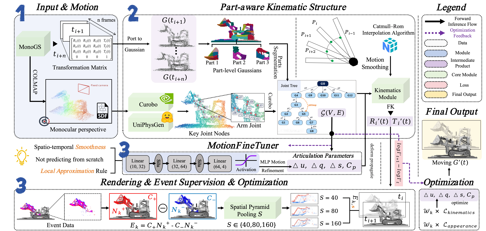
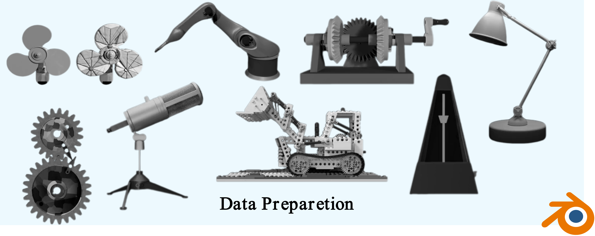
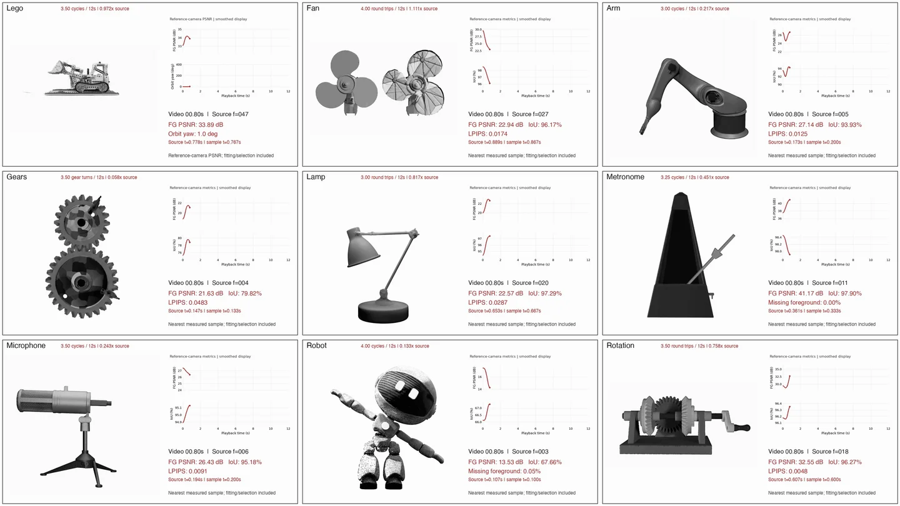

# MERCY

**Monocular Event-boosted Locally Rigid Motion and Coherent 4D Gaussian Reconstruction**

MERCY combines monocular RGB observations, event supervision, articulated motion priors, and locally rigid Gaussian representations. This repository is a curated research-code release derived from SC-GS, with one documented MERCY pipeline and its required implementation dependencies.



## Release scope

The retained pipeline performs joint-constrained motion refinement, coherent binding, surface reconstruction, appearance refinement, bounded local joint-MLP compensation, and Gaussian sequence export. Original Blender motion and geometry priors are explicit inputs. This is not an end-to-end reconstruction of unknown motion or unseen surfaces from events alone.

Historical five-scene adaptation experiments, alternative standalone training branches, generated outputs, caches, raw datasets, checkpoints, deployment files, and duplicate media are excluded. Version-like filenames in required dependencies are preserved for checkpoint and import compatibility; they do not define separate supported releases. No measured claim of a globally best checkpoint is made: the source does not provide a single independently validated winner across all scenes.

## Installation

Use Linux with an NVIDIA CUDA GPU for rendering and optimization. Python 3.10 is recommended. Install a compatible PyTorch, CUDA toolkit, and PyTorch3D environment before the requirements below. The original event environment used PyTorch 2.1.2; this release has not independently validated a complete GPU environment.

```bash
git clone --recurse-submodules https://github.com/SuleynanAuir/MERCY.git
cd MERCY
python -m venv .venv
source .venv/bin/activate
# Install PyTorch and PyTorch3D matching your CUDA environment first.
pip install -r requirements.txt
pip install ./submodules/simple-knn
pip install ./submodules/diff-gaussian-rasterization
```

Blender is required when extracting source geometry or animation. Use explicit paths for your own data and output directories. Large assets are intentionally distributed separately from source code; no downloadable checkpoint or dataset is promised by this release.

## Pipeline entry points

Run scripts from the repository root. Inspect each entry point with `--help` after installing its dependencies; the stages require scene-specific assets and are not a universal one-command trainer.

| Stage | Entry point |
| --- | --- |
| Joint structure | `scripts/motion/lego_joint_structure.py` |
| Event-guided motion | `scripts/events/refine_lego_temporal.py` |
| Coherent binding | `scripts/motion/rebind_lego_coherent.py` |
| Rigid surface reconstruction | `scripts/geometry/rebuild_lego_rigid_surfaces.py` |
| Geometry-prior completion | `scripts/geometry/build_lego_multiview_completion.py` |
| Appearance refinement | `scripts/appearance/refine_lego_appearance.py` |
| Local joint MLP | `scripts/deformation/train_v4_local_mlp.py` |
| Audited sequence export | `scripts/events/export_lego_event_preview.py` |
| Lossless sequence packing | `scripts/export/pack_gaussian_sequence.py` |

For example, local MLP training consumes an existing, provenance-compatible base-field checkpoint:

```bash
python scripts/deformation/train_v4_local_mlp.py \
  --base-field /path/to/base-field.pt --output outputs/local-joint-mlp --steps 800
```

This stage freezes the parent MERCY representation and uses training events for bounded joint compensation. Keep the parent model, camera, event calibration, joint assignments, and checkpoint hashes together. Do not apply compensation twice to an already baked sequence. See [reproduction notes](docs/REPRODUCTION.md).

## Dataset and visual reference



The source project presents nine scenes: Arm, Fan, Gears, Lamp, Lego, Metronome, Microphone, Robot, and Rotation. The curated command-line pipeline is primarily Lego-specific; this image does not imply that every scene has an interchangeable training configuration.



These figures are retained source-project illustrations, not new results reproduced during repository cleanup. No historical performance table is promoted to a verified benchmark here.

## Validation

```bash
python scripts/check_release.py
```

GitHub Actions runs the same dependency-free source and packaging checks. GPU training and rendering require the original assets and CUDA environment and are not covered by this check.

## Attribution and license

This project builds on SC-GS, Deformable 3D Gaussians, and 3D Gaussian Splatting. The original MERCY documentation credits Liang Yirui, Chen Qianqi, and Li Minghao. Retained SC-GS code remains subject to its [upstream MIT notice](docs/LICENSE-SC-GS); see also the repository [LICENSE](LICENSE). CUDA submodules carry their own licenses.

See [release provenance](docs/RELEASE.md) for selection criteria and source hashes.
